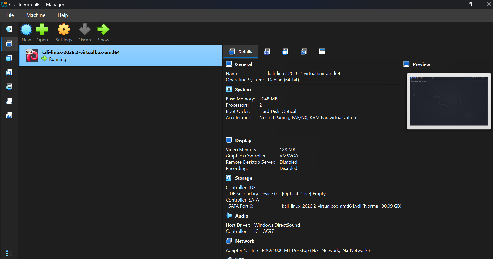
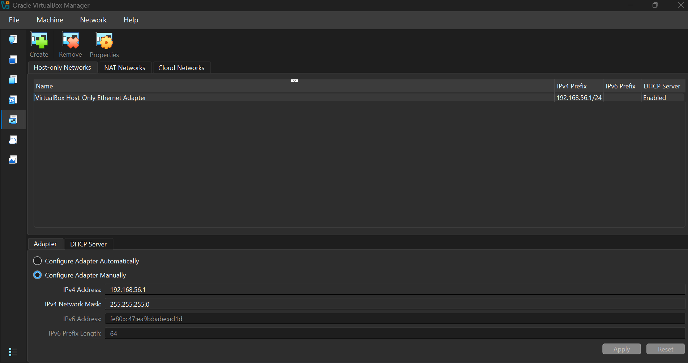

# NETWORKWALKS-B084-WK1-PM1-CYBERSECURITY-LAB-SETUP
Cyber Security Lab Setup
# NETWORKWALKS-B084-WK1-PM1-CYBERSECURITY-LAB-SETUP

## Overview
This repository documents the completion of Week 1 Performance Task 1 (WK1-PM1) for the Networkwalks Cybersecurity Internship. The primary objective was to configure and verify the local virtual penetration testing lab environment using Oracle VM VirtualBox and Kali Linux in accordance with the official lab setup guidelines.

---

## Lab Environment & Configuration Summary

* **Hypervisor:** Oracle VM VirtualBox[cite: 8]
* **Guest Operating System:** Kali Linux 2026.2 (Debian 64-bit)[cite: 8]
* **Allocated Hardware Resources:**
  * **Base Memory (RAM):** 2048 MB (2 GB)[cite: 8]
  * **Processors (CPU):** 2 Cores[cite: 8]
  * **Storage:** 80.09 GB VDI (Dynamic)[cite: 8]
  * **Graphics Controller:** VMSVGA (128 MB Video Memory)[cite: 8]
* **Networking Setup:**
  * **Adapter 1:** NAT Network (`NatNetwork`) for secure internet access[cite: 8]
  * **Host-Only Adapter:** Configured manually with IPv4 Address `192.168.56.1` and Subnet Mask `255.255.255.0` with DHCP enabled[cite: 7].

---

## Step-by-Step Implementation

1. **VirtualBox & VM Verification:** Verified the existing Oracle VM VirtualBox setup and checked the pre-configured Kali Linux virtual machine parameters (RAM, CPU cores, and storage controllers)[cite: 8].
2. **Network Adapter Configuration:** Configured the VirtualBox Host-Only Ethernet Adapter and NAT Network settings precisely as outlined in the Networkwalks lab guide to ensure isolated host-to-VM communication and secure internet access[cite: 7, 8].
3. **System Boot & Access:** Started the virtual machine, verified proper system booting, and successfully reached the Kali Linux graphical desktop login interface[cite: 6, 8].

---

## Lab Proof & Screenshots

### 1. VirtualBox Virtual Machine Overview & Details
[cite: 8]

### 2. Network Configuration (Host-Only Adapter Settings)
[cite: 7]

### 3. Kali Linux Boot & Login Interface
.jpg)[cite: 6]

---

## Conclusion
The cybersecurity laboratory environment has been successfully configured, verified, and documented according to the Networkwalks lab standards, providing a stable platform for upcoming penetration testing tasks.
